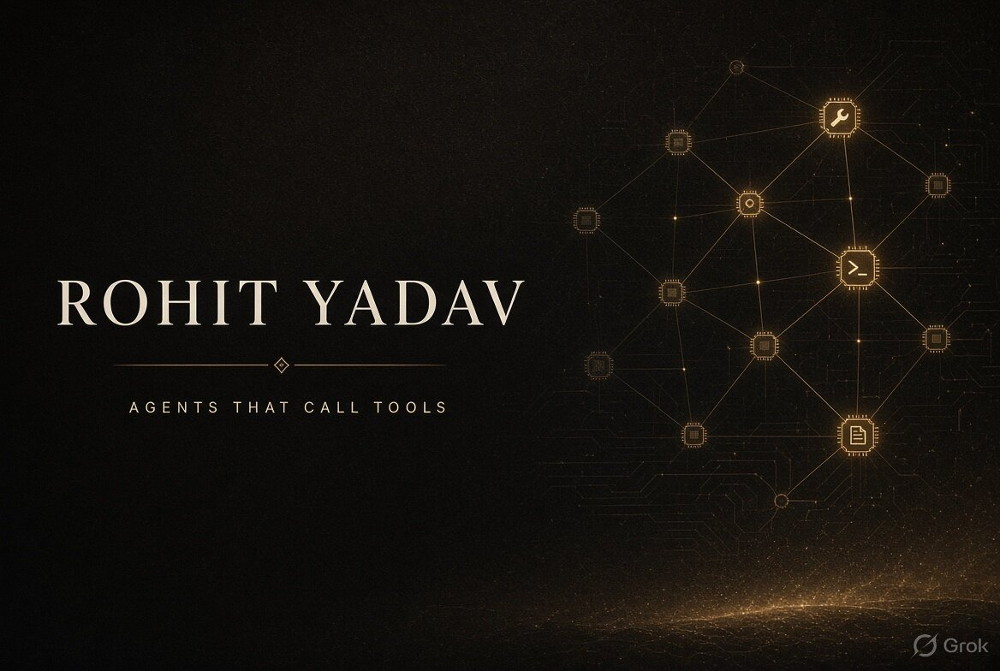

# Hi, I'm Botta Rohit Yadav 👋

**Junior .NET Backend Developer · C# · ASP.NET Core · LLM & Agentic AI projects in Python**

---

### About me

I'm a backend-focused developer working with C# and .NET, and a 2024 B.Tech CSE (IoT) graduate from Visakhapatnam, India, now pursuing an M.Tech in AI/ML. I build REST APIs with ASP.NET Core and Entity Framework Core, and on the side I build small Python agents with the OpenAI Agents SDK, LangChain and MCP tool calling.

### Currently

- 💼 Full Stack .NET Developer Intern at **RQB Technologies** (since Jan 2026)
- 🎓 **Pursuing M.Tech in AI/ML** (B.Tech CSE (IoT), 2024)
- 🛠️ Building [career-copilot-agent](https://github.com/rohit-dev45/career-copilot-agent), a human-in-the-loop job-search and content pipeline
- 🔭 Open to **junior .NET backend / full stack** and **entry-level LLM / agentic AI** roles in India or remote

---

### Tech stack

**Backend**
 

**Databases**
 

**LLM & agentic AI**
 

**Front end & tools**
 

Also familiar with LangGraph.

---

### Featured projects

 

 

 

Employee Management System links to the front-end repo; the ASP.NET Core backend isn't public yet. Parampara live demo: <a href="https://parampara-ashy.vercel.app/">parampara-ashy.vercel.app</a>

--- | --- | --- |
| 🧭 [**career-copilot-agent**](https://github.com/rohit-dev45/career-copilot-agent) | Human-in-the-loop Python pipeline for job-fit scoring, CSV tracking and fact-checked LinkedIn carousel generation. No LinkedIn automation. | Python · Pillow · pytest |
| 🛎️ [**DevOpsDesk**](https://github.com/rohit-dev45/devops-desk) | Multi-agent DevOps support desk: a triage agent hands off to Incidents, CI/CD and Access specialists that call function tools on a mock CMDB, with an input guardrail and write actions refused. | Python · OpenAI Agents SDK |
| 👨‍🏫 [**Programming Tutor Agent**](https://github.com/rohit-dev45/programming-tutor-agent) | LangChain agent on Gemini 2.5 Flash that calls a custom 13-tool FastMCP server through an MCP client, then explains each result. | Python · LangChain · FastMCP |
| 🗂️ **Employee Management System** | ASP.NET Core Web API with EF Core and SQL Server, JWT auth and role-based access control. Front end: [repo](https://github.com/rohit-dev45/Employee-management-system-only-front-end). | C# · ASP.NET Core · EF Core · SQL Server |
| 🎶 [**Parampara**](https://github.com/rohit-dev45/parampara) | Force-directed graph explorer of Indian classical music lineages, gharanas and ragas. [Live demo](https://parampara-ashy.vercel.app/) | TypeScript · React · Neo4j · Cypher |
| 🏦 [**banking-system**](https://github.com/rohit-dev45/banking-system) | Backend Java banking project. | Java |

---

### GitHub stats

  
  

---

**Let's connect:** [LinkedIn](https://www.linkedin.com/in/botta-rohit-yadav/) · [Portfolio](https://rohityadavportfolio.lovable.app/) · [rohit.botta5@gmail.com](mailto:rohit.botta5@gmail.com)

